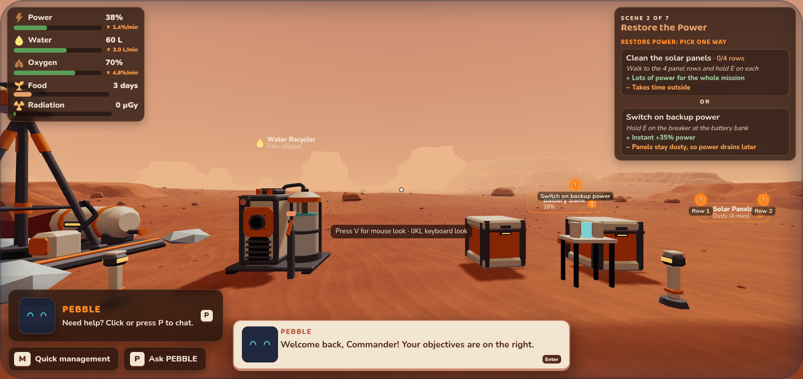
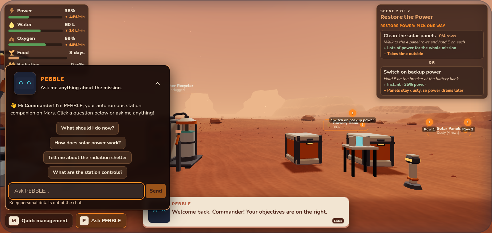
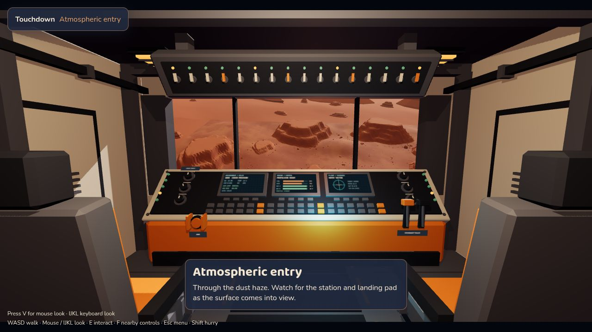
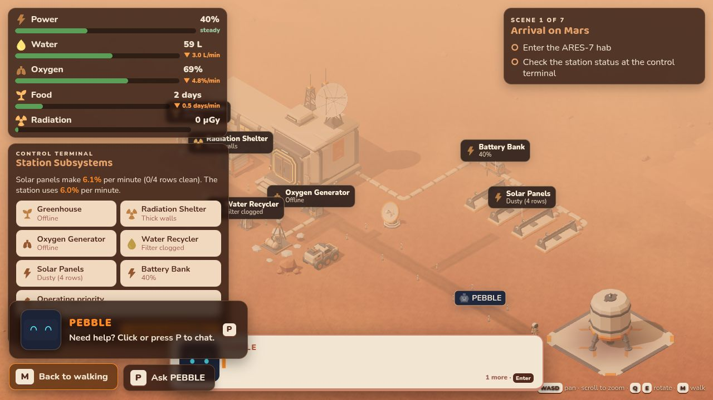
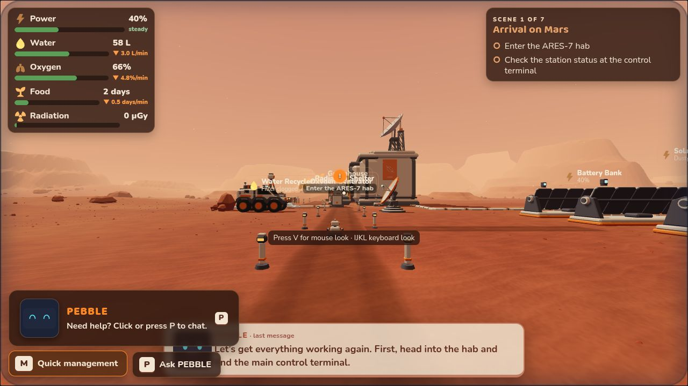
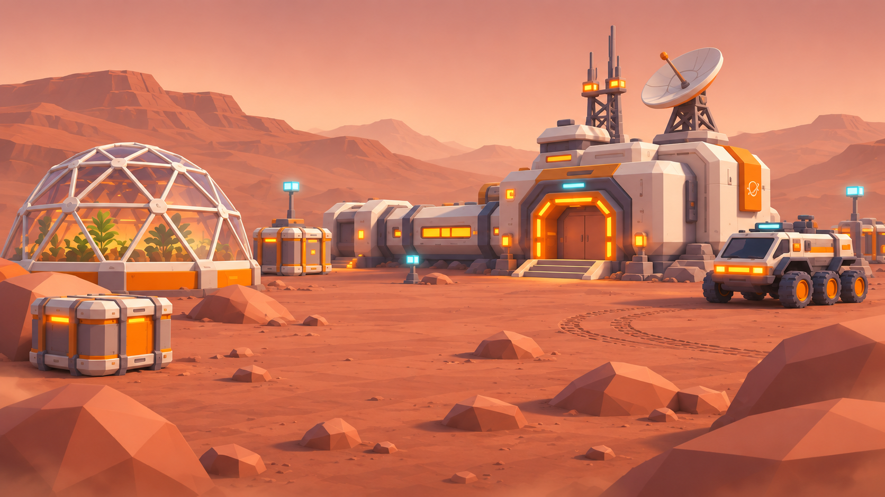

<div align="center">

# Mars Life Line

**Every watt. Every breath. Every choice.**

A stylized 3D Mars survival game about keeping a station alive—with a little help from PEBBLE.

[**Play in your browser**](https://baraa404.github.io/mars-life-line-game/) · [Get started](#play-locally) · [Controls](#controls) · [Development](#development) · [Design documents](game-design/00-START-HERE.md)



</div>

## Welcome to ARES-7

A dust storm has knocked out the station's systems. You've just landed, the next crew is on its way, and your robot companion PEBBLE is ready to help. Restore power, bring life support online, grow food, and decide how to share the resources that keep everything running.

Cleaning the solar panels takes time outside. Backup power is quick, but finite. Making oxygen takes water. Growing food needs both water and electricity. Your choices shape the station—and the report you send home.

## Inside the game

- **Explore a miniature Mars outpost.** Walk through a low-poly world of habitats, solar arrays, life-support equipment, and rust-red terrain.
- **Play a seven-scene mission.** Arrive, repair the station, restore its systems, choose operating priorities, and respond to a radiation storm.
- **Watch resources respond.** Track power, water, oxygen, food, and radiation as station systems interact.
- **Meet PEBBLE.** Get mission dialogue and contextual help from your robot companion.
- **Switch perspectives.** Move between first-person exploration and an overhead management view.
- **Review the outcome.** Finish with a mission report that connects your decisions to their consequences.

This is a playable project under active development. The design documents also describe longer-term ideas beyond the current mission.

## A closer look
### Your robot companion



### Fresh screenshots

Captured from the running game: the landing cabin, the station management view, and the walk to ARES-7.







### The visual direction

The world uses chunky silhouettes, ivory machinery, orange panels, dark recesses, and warm terracotta landscapes.



*Visual development reference; the images above it show the game running.*

## Play online

[Launch Mars Life Line](https://baraa404.github.io/mars-life-line-game/) in a desktop browser with WebGL support. No install or API key is needed.

## Play locally

Use a recent Node.js release compatible with Vite 8 (Node 22.12+ recommended) and npm. You'll need a desktop browser with WebGL support.

```sh
git clone https://github.com/baraa404/mars-life-line-game.git
cd mars-life-line-game
npm ci
npm run dev
```

Open the local URL printed by Vite, usually `http://localhost:5173`, and choose **New Game**.

The standard mission and PEBBLE's built-in responses work without an API key.

## Controls

- **WASD / arrow keys:** move.
- **Mouse:** look around; **V** captures the mouse. **IJKL** also controls the view.
- **Shift:** run. **Space:** jump.
- **Hold E:** interact with nearby equipment.
- **M:** switch to quick management / overhead view.
- **P:** ask PEBBLE.
- **Esc:** close a panel, leave management view, or pause.

Follow the prompts in the game for context-specific actions.

## Development

Built with **React**, **TypeScript**, **Three.js**, **React Three Fiber**, **Drei**, **Rapier**, **Zustand**, and **Vite**. The project includes procedural 3D asset sources and original synthesized audio.

```sh
npm run dev        # Development server
npm run build      # TypeScript checks + production build
npm run preview    # Preview the production build locally
npm run lint       # Oxlint checks
npm test           # Simulation, world, and asset regression checks
npm run sim:check  # Headless 60-sol simulation
```

### Optional local PEBBLE AI demo

For local adult testing, copy `.env.example` to `.env.local`, set `GEMINI_API_KEY`, and set `PEBBLE_LOCAL_DEMO=1`. Then start `npm run dev`. The key stays on the local server; never commit `.env.local`.

This optional mode sends messages, recent conversation history, and selected station readings to Google Gemini. Keep it local and follow the provider's applicable terms. The regular game uses built-in responses when the demo is disabled. `npm run pebble:serve` runs the local API separately.

## Explore the project

- [`src/game`](src/game): world, assets, camera, interaction, and audio.
- [`src/sim`](src/sim): resource simulation, mission logic, and dialogue.
- [`src/ui`](src/ui): menus, resource meters, management screens, and PEBBLE.
- [`public`](public): runtime models, interface artwork, fonts, and audio.
- [`models and assets images`](models%20and%20assets%20images): flat reference library with images and a model.
- [`assets/source`](assets/source): procedural model source files.
- [`tests`](tests): simulation and world regression coverage.
- [`game-design`](game-design/00-START-HERE.md): vision, systems, missions, and asset catalog.
- [`docs`](docs/README.md): technical notes, visual style, and the asset pipeline.

The standard game runs from the checked-in assets. Optional Kiln authoring commands require a separate local Kiln installation; local agent configuration and generated tooling state are excluded from this repository.

## Credits and usage

The game includes science references linked from its in-game information panels and design documents. It is a fictional mission and an educational prototype, not operational spaceflight software.

Original generated audio has its own [CC0 dedication](public/audio/LICENSE.txt). That dedication applies to the audio recordings only; it does not grant a license to the rest of the project. Third-party libraries retain their respective licenses.
